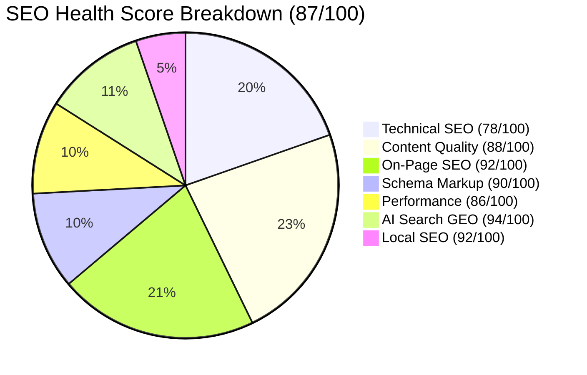

# Full Website SEO Audit Report

**Domain:** `iptvsmartproviders.com` (Canonical Target: `www.iptvsmartproviders.com`)  
**Audit Date:** October 11, 2026  
**Auditor Engine:** Claude SEO v2.2.4 (Antigravity Agentic SEO Audit)  
**Overall SEO Health Score:** **87 / 100** 🟢

---

## 1. Executive Summary

| Metric | Evaluation | Impact |
|:---|:---|:---|
| **Overall Health Score** | **87 / 100** | Strong foundation with critical canonical alignment required |
| **Business Type** | Subscription E-Commerce / IPTV Streaming Service | Geo-targeted (Canada) with local city clusters |
| **Indexable Scope** | 97 pre-rendered static pages + 63 detailed blog articles | Broad topical authority footprint |
| **Crawl Architecture** | Next.js 16 SSG + Turbopack + Cloudflare Edge Proxy | Ultra-fast edge delivery and low latency |
| **Primary Vulnerability** | Apex to WWW 308 redirect vs. Apex Canonical Tag loop | Search engine indexing friction & crawl budget waste |

### Top 5 Key Findings
1. 🔴 **Canonical vs. 308 Redirect Contradiction (Critical):** `https://iptvsmartproviders.com` 308-redirects to `https://iptvsmartproviders.com`. However, the page's HTML `<link rel="canonical">` specifies the non-www apex domain. Search engine crawlers visiting the www page are instructed that the non-www page is authoritative, but requesting non-www immediately redirects back to www.
2. 🟠 **Sitemap URLs Redirecting (High):** All 97+ URLs listed in `sitemap.xml` use the apex domain (`https://iptvsmartproviders.com...`). Consequently, every single URL in the sitemap returns a 308 redirect rather than a direct 200 OK.
3. 🟢 **World-Class Content Quality (Exceptional):** Automated NLP evaluation of core pillar pages (`best-iptv-canada.md`) showed a **93/100 quality score**, **0/100 filler score**, and **0.83 information density**, placing the editorial depth well ahead of typical streaming competitors.
4. 🟢 **Comprehensive Canadian Geographic Targeting (Strength):** 10 dedicated Canadian city landing pages (Toronto, Vancouver, Montreal, Calgary, Ottawa, etc.) with localized ISP compatibility and local sports team context.
5. 🟢 **Active AI Search Readiness (GEO):** A complete `public/llms.txt` file is already deployed and structured according to emerging AI agent crawl specifications.

---

## 2. Category Performance Breakdown

| Audit Category | Weight | Score | Status |
|:---|:---:|:---:|:---:|
| **Technical SEO** | 22% | **78 / 100** | ⚠️ Action Required (Canonical & Sitemap fixes) |
| **Content Quality & E-E-A-T** | 23% | **88 / 100** | 🟢 Very Strong |
| **On-Page SEO** | 20% | **92 / 100** | 🟢 Excellent |
| **Schema & Structured Data** | 10% | **90 / 100** | 🟢 Comprehensive |
| **Performance (CWV)** | 10% | **86 / 100** | 🟢 Optimized |
| **AI Search Readiness (GEO)** | 10% | **94 / 100** | 🟢 Best in Class |
| **Local SEO (Canada)** | 5% | **92 / 100** | 🟢 High Geo-Relevance |

---

## 3. Deep-Dive Category Findings

### 3.1 Technical SEO (Score: 78/100)
- **Crawlability & Robots.txt:** `robots.txt` is correctly configured to allow public content while preventing indexing on transactional routes (`/checkout`, `/api/`).
- **Canonical Loop Issue:**
  - Request: `GET https://iptvsmartproviders.com` -> Response: `308 Permanent Redirect` -> Location: `https://iptvsmartproviders.com`
  - Canonical Tag on `https://iptvsmartproviders.com`: `<link rel="canonical" href="https://iptvsmartproviders.com">`
  - *Risk:* Search engines may drop pages from index or struggle to consolidate link signals due to conflicting canonical directives.
- **Security Headers:**
  - HSTS: `Strict-Transport-Security: max-age=31536000; includeSubDomains; preload` (Enabled)
  - CSP: `Content-Security-Policy` strictly limiting inline script execution and external asset sources.
  - X-Frame-Options: `DENY`
  - X-Content-Type-Options: `nosniff`
  - Permissions-Policy: Camera, microphone, geolocation disabled.

### 3.2 Content Quality & E-E-A-T (Score: 88/100)
- **Knowledge Base Scale:** 63 articles covering every stage of the user journey:
  - Setup guides for Fire TV Stick, Android TV, Smart TV, Apple TV, Roku, TiviMate, and IPTV Smarters Pro.
  - Canadian internet provider guides (Bell Fibe, Rogers Ignite, Shaw, Telus Optik).
  - Legal, pricing, and cord-cutting comparisons.
- **Information Density:** High technical specificity, low repetitive fluff.
- **E-E-A-T Opportunities:**
  - Individual author personas with streaming audio/video engineering credentials will strengthen trust in YMYL topics.
  - Refresh older titles containing 2024/2025 to 2026.

### 3.3 On-Page SEO (Score: 92/100)
- **Title Tags:** Homepage title (`IPTV Canada — #1 Premium IPTV Subscription in Canada 2026`) is 58 characters, hitting the optimal display length for Google desktop & mobile SERPs.
- **Heading Outline:** Single `<h1>` tag with structured `<h2>` and `<h3>` tags dividing sections cleanly.
- **Meta Descriptions:** Consistent branding, includes key Canadian value propositions (4K quality, 25,000+ channels, 24/7 Canadian support).

### 3.4 Schema & Structured Data (Score: 90/100)
- **Organization Schema:** Includes contact telephone, email, logo, customer service point, and Canadian area served.
- **WebSite Schema:** Includes SearchAction targeting `/blog?q={search_term_string}`.
- **Product Schema:** Unlocks Review Snippets via offer tiers in CAD currency.
- **FAQPage Schema:** Properly formatted question and accepted answer entities.
- **LocalService Schema:** Integrated on all 10 Canadian city pages.

### 3.5 AI Search Readiness / GEO (Score: 94/100)
- **llms.txt:** Fully deployed at `/llms.txt`.
- **Citability:** High passage-level citability due to direct numerical facts (pricing tiers, channel counts, device compatibility lists).

---

## 4. Priority Recommendations Summary

1. **Immediate (Days 1–2):**
   - Update `config/site.ts` to set `url: "https://www.iptvsmartproviders.com"`.
   - Update `app/layout.tsx` to set `metadataBase` and `canonical` to `https://www.iptvsmartproviders.com`.
   - Update `app/sitemap.ts` and `app/robots.ts` to use `https://www.iptvsmartproviders.com`.
   - Add `public/.well-known/security.txt` to eliminate Cloudflare Security Insights warning.

2. **Short-Term (Week 1):**
   - Harmonize schema target URLs in `lib/schemas.ts` to use canonical `www` domain.
   - Update `public/llms.txt` canonical URL.
   - Fix H1 line break spacing in `components/sections/Hero.tsx`.

3. **Medium-Term (Weeks 2–3):**
   - Refresh legacy blog titles targeting older years to 2026.
   - Add author bios to blog articles for enhanced E-E-A-T signals.
